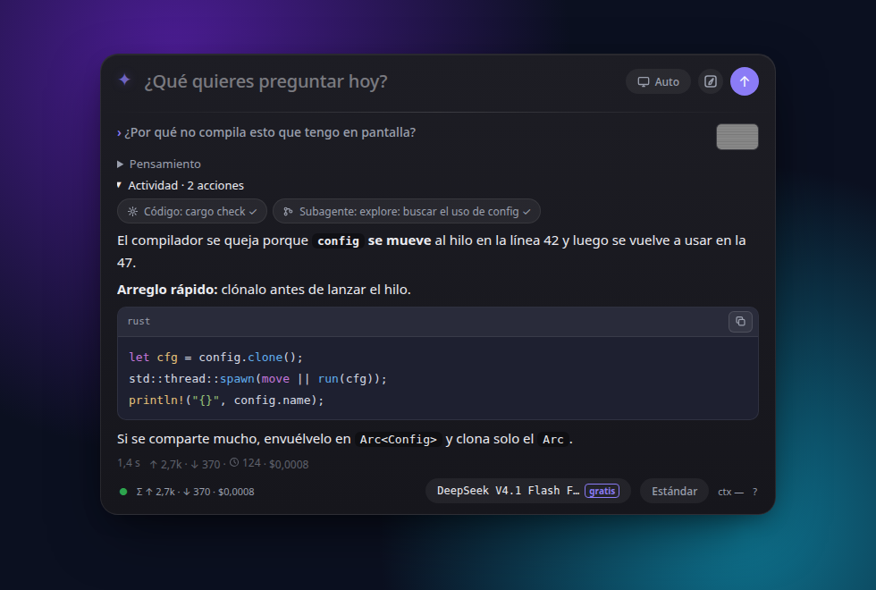
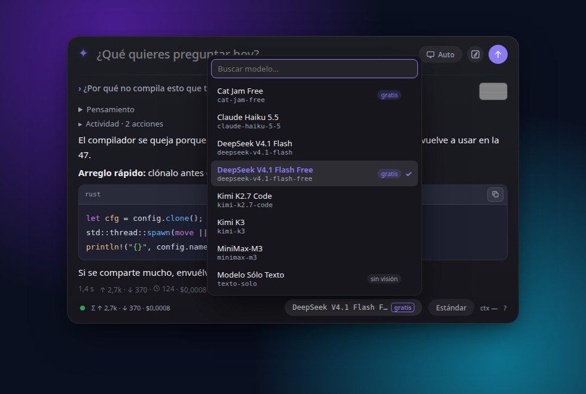
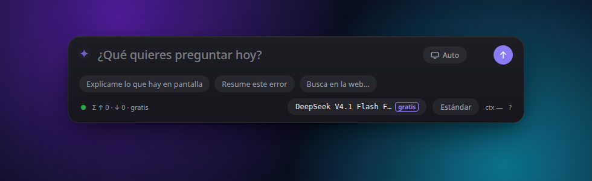

<div align="center">

# ✦ quickask

### *Pregunta lo que sea desde cualquier sitio, con un atajo de teclado*

[](https://www.rust-lang.org)
[](https://tauri.app)
[](https://www.typescriptlang.org)
[](https://opencode.ai)
[](#-requisitos)
[](#-elegir-el-modelo)
[](LICENSE)

**Una barra flotante para Linux que abre `Ctrl+Alt+Espacio`. Escribes, pulsas Enter y la respuesta llega en streaming.
Por debajo responde [OpenCode](https://opencode.ai), así que tienes todas sus skills, MCP, herramientas y subagentes, y
puedes usar el modelo que quieras. Si la pregunta va sobre lo que tienes en pantalla, adjunta una captura sola.**

</div>

---



## ✨ Qué hace

- ⚡ **Aparece al instante**: un proceso residente con la ventana precargada. `Esc` la oculta y el atajo la vuelve a
  abrir con la conversación intacta.
- 🖥️ **Ve tu pantalla**: si preguntas *"¿qué es este error?"* o *"resume esto"*, se adjunta una captura de la
  pantalla tal y como estaba al pulsar el atajo. El chip **Auto / Sí / No** (`Ctrl+Shift+S`) lo fuerza.
- 🧰 **Todo lo de tu agente**: la sesión es de OpenCode, con tus skills, MCP, herramientas y subagentes. Cada acción
  aparece como un chip (código, subagente, lectura…) y lo que necesita permiso se pide con una tarjeta.
- 🧠 **El modelo que quieras**: selector con buscador sobre el catálogo real de OpenCode, nivel de esfuerzo según el
  modelo y un modelo de relevo opcional si el principal falla.
- 🛑 **Salida de seguridad**: el turno se corta solo si el agente se atasca, repite el mismo paso o se pasa de
  acciones o de tiempo, y te deja un resumen de lo que hizo.
- 📊 **Consumo a la vista**: tokens, caché, razonamiento, coste y contexto ocupado en la barra de estado.
- ↗️ **Sigue en la terminal**: `Ctrl+O` abre la conversación en `opencode` para continuarla con calma.



## 📦 Requisitos

- Linux con **GNOME** (probado en GNOME 46 sobre Wayland). El atajo global se registra como atajo personalizado de
  GNOME y la captura usa `gnome-screenshot`.
- [OpenCode](https://opencode.ai) **v2** con el servicio en segundo plano (`opencode service start`). quickask lo
  arranca solo si no está corriendo.
- Rust estable, [`tauri-cli`](https://v2.tauri.app/reference/cli/) v2 (`cargo install tauri-cli --version "^2"`),
  Node.js 20+ y las librerías de desarrollo de WebKitGTK 4.1 y GTK 3.
- Opcionales: `notify-send` (aviso cuando la respuesta llega con la barra oculta) y `gnome-terminal` (`Ctrl+O`).

> 🔐 **Sin cuentas ni claves dentro.** quickask no habla con ningún proveedor de IA: solo con tu OpenCode local
> (`127.0.0.1`), usando la contraseña que el propio servicio deja en `~/.local/state/opencode/service.json`. Las
> claves de los proveedores viven en tu configuración de OpenCode, nunca en este repositorio.

## 🚀 Instalación

```sh
git clone https://github.com/carlos-anpr/quickask.git
cd quickask
./scripts/install.sh
```

El script compila en modo release, instala el binario en `~/.local/bin/quickask`, lo añade al inicio de sesión,
registra el atajo `Ctrl+Alt+Espacio` en GNOME (sin tocar tus otros atajos) y lo arranca.

Para quitarlo (la configuración y las conversaciones se conservan):

```sh
./scripts/uninstall.sh
```

## 🧠 Elegir el modelo

Por defecto usa **`opencode/deepseek-v4.1-flash-free`**, un modelo gratuito de OpenCode Zen que funciona sin
suscripción. Puedes poner cualquier otro que tengas configurado en OpenCode (formato `proveedor/modelo`) de tres
formas:

**1. Variables de entorno** (mandan sobre el fichero):

| Variable | Qué hace | Ejemplo |
|---|---|---|
| `QUICKASK_MODEL` | Modelo principal | `anthropic/claude-sonnet-5-5` |
| `QUICKASK_FALLBACK_MODEL` | Relevo si el principal falla (vacía = sin relevo) | `opencode/deepseek-v4.1-flash-free` |
| `QUICKASK_MODEL_PROVIDERS` | Proveedores cuyo catálogo sale en el selector, separados por comas | `opencode,anthropic,openrouter` |

Como quickask arranca con la sesión, ponlas en `~/.config/environment.d/quickask.conf`:

```ini
QUICKASK_MODEL=openrouter/qwen/qwen3.8-27b
QUICKASK_FALLBACK_MODEL=opencode/deepseek-v4.1-flash-free
QUICKASK_MODEL_PROVIDERS=opencode,openrouter
```

y vuelve a iniciar sesión (o lánzalo a mano con `QUICKASK_MODEL=… quickask`).

**2. El selector de la barra**: elige el modelo con el ratón o escribiendo para filtrar. Se guarda en
`config.toml`, pero si hay una variable de entorno, la variable vuelve a mandar en el siguiente arranque.

**3. `~/.config/quickask/config.toml`**, que se crea con los valores por defecto la primera vez:

```toml
shortcut = "<Control><Alt>space"  # al cambiarlo, vuelve a ejecutar install.sh
model = "opencode/deepseek-v4.1-flash-free"
fallback_model = ""                 # "" = sin relevo
model_providers = ["opencode"]      # catálogos que salen en el selector
variant = ""                        # esfuerzo: "", low, high, max… según el modelo
workdir = "~/"                      # carpeta de trabajo de las sesiones
hide_on_blur = true
notify_when_hidden = true
screen_auto = true                  # adjuntar la pantalla cuando la pregunta lo pide
theme = "system"                    # system, dark o light
ask_permissions = []                # acciones que siempre piden permiso, p. ej. ["shell"]
turn_timeout_secs = 300
stall_timeout_secs = 180
max_tool_calls = 40
max_step_repeats = 3
```

## 📝 Instrucciones propias

Cada conversación arranca con unas instrucciones de serie (responder breve, cuándo usar la captura, pedir
confirmación antes de cualquier acción hacia otras personas…). Para cambiarlas, crea
`~/.config/quickask/instructions.md` con las tuyas: sustituye por completo a las de serie. Es el sitio para decirle
qué skills o MCP usar con tus sistemas, en qué idioma responder o cómo manejar tu navegador.

## ⌨️ Atajos

| Atajo | Acción |
|---|---|
| `Ctrl+Alt+Espacio` | Mostrar u ocultar la barra |
| `Enter` / `Shift+Enter` | Enviar / salto de línea |
| `Esc` | Cerrar el menú abierto, borrar lo escrito o, si no hay nada, ocultar |
| `Ctrl+N` | Conversación nueva |
| `Ctrl+O` | Abrir la conversación en `opencode` en una terminal |
| `Ctrl+Shift+S` | Captura de pantalla: Auto → Sí → No |



## 🧪 Línea de comandos

```sh
quickask --toggle              # lo que hace el atajo
quickask --background          # arrancar sin mostrar la ventana
quickask --quit                # cerrar el proceso residente
quickask --ask "pregunta"      # sin ventana: imprime la respuesta en la terminal
quickask --ask "¿qué ves?" --screen
```

## 🛠️ Desarrollo

```sh
npm --prefix ui ci
npm --prefix ui run dev        # la UI en el navegador, con un backend simulado
npm --prefix ui test
cd src-tauri && cargo test
cargo tauri dev                # la app completa
```

La UI (TypeScript + Vite, sin framework) y el backend (Rust + Tauri v2) se hablan con un contrato de eventos
(`ui/src/contract.ts` ↔ `src-tauri/src/events.rs`). El backend traduce el SSE de OpenCode a esos eventos en
`src-tauri/src/translate.rs`, con fixtures de turnos reales en `fixtures/`.

## 📄 Licencia

[MIT](LICENSE)
